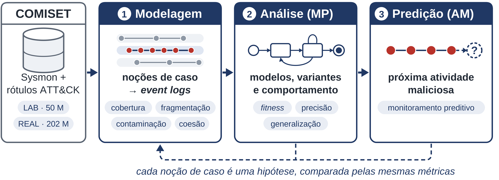
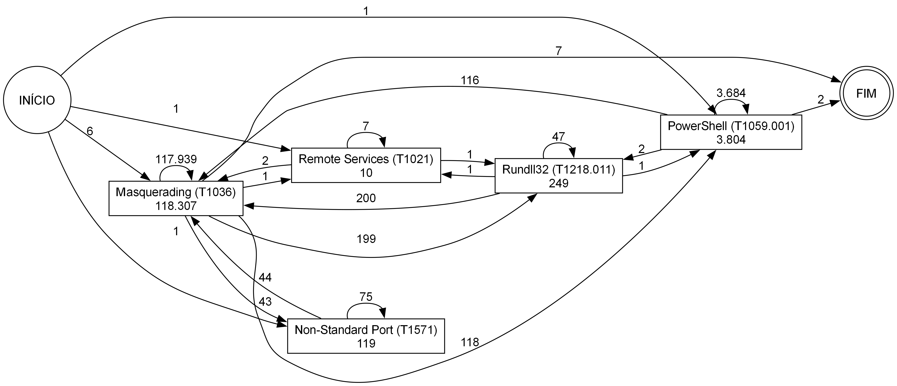

# Mestrado: Mineração de Processos na COMISET

**João Pedro Ramires Esteves - 12522CCP018**

> **Pergunta:** como agrupar eventos do log Windows em casos (isto é, ter uma *noção de caso*) de forma que seja
> possível aplicar técnicas de Mineração de Processos (MP) a fim de revelar a estrutura dos comportamentos potencialmente maliciosos?

> Em logs de sistema, diferente de processos de negócio, não há um identificador natural de caso. Neste trabalho,
> a noção de caso deixa de ser uma <ins>premissa</ins> e passa a ser o <ins>objeto de estudo</ins>.

## Visão Geral do Trabalho



## Base de Dados

A base à qual o método é aplicado denomina-se [COMISET](https://doi.org/10.5281/zenodo.15375145) (Pérez-Sánchez et al., 2025).

Possui $\approx 252M$ eventos Windows, majoritariamente provindos do
[Sysmon](https://learn.microsoft.com/pt-br/sysinternals/downloads/sysmon), mas também há eventos do log nativo.

Os registros também foram enriquecidos com rótulos de técnicas MITRE ATT&CK®, com uma divisão em dois cenários:

| Cenário | Eventos | Maliciosos (Alertas) | Período |
|---------|--------:|---------------------:|---------|
| **LAB** (ambiente controlado) | $\approx 50M$  | $1,71M$ (3,43%) | 16-25/nov/2022 | 
| **REAL** (rede universitária) | $\approx 202M$ | $0,63M$ (0,31%) | 27/jun-20/jul/2022 |


## Webapp Streamlit

O [Notebook 4](4_replicacao_sean.ipynb) foi usado de base para a criação de um [app Streamlit](https://streamlit.io/), disponível em https://comiset-models.streamlit.app/.

> Pode ser que, ao acessar o link, você tenha que "acordar" o app. Isso é normal, basta clicar no botão indicativo. Demora só alguns segundos.

Seu módulo principal é o arquivo [`app.py`](app.py), porém sua lógica também reside em [`interface/`](interface/) e [`comiset/`](comiset/).

A ideia é explorar diferentes noções de caso interativamente.

Também é possível explorar diferentes filtros e visualizações.

## O que já foi feito

Os notebooks estão numerados em ordem cronológica.

### 1. Engenharia de dados: [`1.1`](1.1_compressao_lab.ipynb) e [`1.2`](1.2_compressao_real.ipynb)

[No Zenodo](https://zenodo.org/records/15375146), os arquivos brutos do artigo (um para cada cenário) foram disponibilizados como JSON.

Devido a seus tamanhos, o bruto foi convertido em Parquet com DuckDB, sem descartar nenhum campo.

Para o cenário LAB: $160GB \rightarrow 2,6GB$.

Para o cenário REAL: $934GB \rightarrow 13,3GB$.

Considerando o agregado de ambos, $\approx 1,1TB \rightarrow 16GB$, ou seja, 98%+ de compressão.

### 2. Exploração: [`2.1`](2.1_exploracao_lab.ipynb) e [`2.2`](2.2_exploracao_real.ipynb)
- O "***schema***" dos dados é **muito heterogêneo**: 1.293 campos distintos no LAB e 897 no REAL, porque cada tipo de evento Sysmon tem um conjunto específico de atributos.
- Os **atributos são extremamente esparsos**: dentre tantos campos, somente 32 (LAB) e 41 (REAL) aparecem em pelo menos 99% dos eventos.
- Rótulos ATT&CK, distribuição de EventID/EventType, e cardinalidades (hosts, usuários, processos, IPs) estão em [`saidas/lab/`](saidas/lab) e [`saidas/real/`](saidas/real).
- Os eventos provindos do Sysmon dominam: só o EventID 12 (`RegistryEvent`) responde por ~70% do LAB.
- Nome de usuário: o atributo `user_name` está em 79% dos eventos do LAB e em só 0,7% do REAL. Isso afetará qualquer noção de caso baseada em usuário.
- Foi feito um recorte das primeiras 24h de cada cenário (`d1`), para iterar rápido: LAB ficou com 3,5M eventos (3,7% maliciosos), REAL com 22M (0,28% maliciosos).

### 3. Primeira noção de caso: `<host, process_guid>` (LAB, d1)
- **[`3.1`](3.1_eventlog_processo_lab.ipynb), construção do event log:** atividade = tipo de evento Sysmon (17 atividades).

  | Cobertura | Casos | Fragmentação (casos com 1 evento) | Coesão estrutural |
  |----------:|------:|----------------------------------:|------------------:|
  | 99,4%     | 2.516 |                               44% |             **0** |

  Como o GUID é único por processo, ele separa pai e filho em casos diferentes, daí vem a coesão zerada.
  
  Isso nos aponta para agregar via árvore de processos. Não é muito promissor, devido ao volume de informação sobre pais e filhos.

- **[`3.2`](3.2_variantes_processo_lab.ipynb), variantes:** reduzindo a resolução temporal para 1s e deduplicando, os $3,5M$ eventos viram $228.000$ (-93,5%).
  
  Resultam 673 variantes, e 25% delas cobrem 80% dos casos.
  
  Cruzando com os rótulos: 149 variantes benignas, 504 maliciosas e 20 mistas, que somam 55% dos casos.
  
  O sinal de ataque aparenta estar na cauda longa.

### 4. Replicação do Sean: [`4`](4_replicacao_sean.ipynb)
Transposição de Alvarenga et al. (2018) para a COMISET, **nos dois cenários completos**:

1. **Alertas**
    - Eventos que possuem rótulo ATT&CK. Ao todo, $2.345.315$.
    - Os IDs de técnica precisaram de limpeza de formatação e rótulos deprecados.
2. **Caso = `<IP de origem, dia>`**
    - Aplicado o mesmo filtro do Sean, descartando-se casos com uma técnica só
    - Visualização enriquecida do DFG + critério de complexidade do artigo (eqs. 2, 5 e 6)
    - Além da atividade, foram adicionados os executáveis associados a ela
3. **Achado principal**
    - No Sysmon quase não há tráfego de *entrada*. São só 587 alertas no LAB e 234 no REAL
    - Então, a replicação literal resulta em **3 casos no LAB e 1 no REAL**, e nenhum modelo é complexo
    - Explicação: no Sysmon, `src_ip` é a máquina monitorada, não o atacante, portanto é necessário verificar a direção por meio do campo `Initiated`
4. **8 noções de caso alternativas** ([`tabela_complexidade.csv`](saidas/sean/tabela_complexidade.csv))
    - As agregações por IP e por processo-alvo continuam gerando modelos simples ($\leq 7$ vértices)
    - Entretanto, **host, usuário, programa (exe) e processo geram modelos complexos**, produzindo de 29 a 45 vértices, e até 580 arestas
    - No Sean, acionariam a etapa de clustering

<p align="center">
  
  <br>
  <sub>DFG Enriquecido: LAB, caso = &lt;IP de origem, dia&gt;, todas as direções, 18/11/2022</sub>
</p>

## Estrutura do repositório

```
├── 1.1 .. 4_*.ipynb  notebooks, na ordem de execução
├── util.py           cron() (cronômetro de célula) e salvar() (em parquet e csv)
├── app.py            o app Streamlit (uv run streamlit run app.py)
├── comiset/          núcleo do webapp: modelagem, DFG, complexidade, desenho
│   └── dados/        alertas.parquet (~12 MiB), a única fonte que o app usa, versionada (está no git)
├── interface/        as telas do app, em Streamlit (páginas, barra lateral, URL, DFG interativo, gráficos)
├── .streamlit/       tema do app (claro e escuro)
├── saidas/           tudo que os notebooks geram
│   ├── lab/  real/   exploração (CSVs e figuras), recortes d1, event log
│   └── sean/         alertas, event logs, DFGs e tabelas do notebook 4
├── dados/            dataset completo em Parquet (fora do git)
├── docs/             material de referência (ver abaixo)
├── wtdcc/            resumo e pôster do WTDCC 2026
└── .githooks/        pre-commit que barra arquivos >50MiB
```

| Documento (`docs/`) | Descrição |
|---------------------|-----------|
| [`perez-sanchez_2025_comiset.pdf`](docs/perez-sanchez_2025_comiset.pdf) | artigo da COMISET (*Data in Brief*) |
| [`campos_lab.md`](docs/campos_lab.md) e [`presenca_campos.xlsx`](docs/presenca_campos.xlsx) | catálogo dos campos do `_source` e a presença de cada um |
| [`exemplo_evento_lab.json`](docs/exemplo_evento_lab.json) e [`exemplo_evento_real.json`](docs/exemplo_evento_real.json) | um exemplo de evento bruto de cada cenário |
| [`pesquisa_ocel.md`](docs/pesquisa_ocel.md) | levantamento sobre OCEL 2.0 e construção de event logs a partir de Sysmon |
| [`plano_app_streamlit.md`](docs/plano_app_streamlit.md) | o plano do app Streamlit e as decisões tomadas na implementação |

> [!NOTE]
> Nem todos os dados estão no git. Alguns arquivos grandes existem só localmente: são pesados demais para o
> GitHub e podem ser refeitos rodando os notebooks.
> - `dados/`: o dataset completo em Parquet (`lab_events.parquet` - 2,6GB; e `real_events.parquet` - 13,3GB), gerado pelos `1.x`;
> - `saidas/*/*_d1*.parquet`: os recortes do 1º dia (185MB a 1,4GB), dos `2.x` e do `3.1`;
> - `saidas/lab/lab_b_*`: o event log da estratégia (b) e derivados, dos `3.x`, incluindo um XES de 2,4GB;
> - `saidas/sean/alertas_*` e `saidas/sean/log_*_todas.*`: os alertas extraídos pelo `4` (19 a 580MB) e os event logs sem filtro de direção (até 91MB).
>
> O webapp não depende de nenhum deles: usa só `comiset/dados/alertas.parquet` (~12 MiB, no git), que sai de
> `saidas/sean/alertas_*` com `uv run python -m comiset.dados`. Ele deixa de fora o `_id` de cada evento, um
> hash que não comprime e que sozinho ocupava ~52 MiB.

## Pré-requisitos

- uv: https://docs.astral.sh/uv/getting-started/installation/
    - Gerenciador do Python. Coordena os pacotes e módulos
- Graphviz: https://graphviz.org/download/
    - Para desenhar os DFGs
    - No Windows, `winget install graphviz`
    - No Linux, o pacote também se chama `graphviz`
- Bastante RAM e disco, já que o JSON bruto tem $\approx 1,1TB$ descompactado.

## Como reproduzir

1. Clonar este repositório:
```bash
git clone https://github.com/jpramires/mestrado.git
```

2. Instalar os pacotes necessários:
```bash
uv sync
```

Pronto! Daqui pra frente, basta escolher sua preferência.

3. **Para explorar os notebooks**:
```bash
uv run jupyter lab
```

4. **Para rodar o Streamlit localmente**:
```bash
uv run streamlit run app.py
```

Caso queira *realmente* verificar todas as etapas.

5. **Para reproduzir todos os experimentos na íntegra**:
    1. Baixe a COMISET do [Zenodo](https://doi.org/10.5281/zenodo.15375145)
    2. Nos notebooks `1.x`, aponte o caminho no qual residem os arquivos JSON. Assim, serão gerados os `dados/`
    3. Rode os notebooks na ordem em que estão numerados
        - O [notebook `4`](./4_replicacao_sean.ipynb) só depende de `dados/` (`lab_events.parquet` e `real_events.parquet`)

### O Webapp Streamlit

O app só precisa de [`comiset/dados/alertas.parquet`](comiset/dados), que já vem no repositório.

Ele não usa nada de `dados/`, e não precisa do Graphviz instalado (o DFG é desenhado no navegador).

## Referências

[1] ALVARENGA, S. C. de; BARBON JUNIOR, S.; MIANI, R. S.; CUKIER, M.; ZARPELÃO, B. B. Process mining and hierarchical clustering to help intrusion alert visualization. Computers & Security, v. 73, p. 474-491, mar. 2018. DOI: 10.1016/j.cose.2017.11.021.- Alvarenga

[2] PÉREZ-SÁNCHEZ, A.; PALACIOS, R.; LÓPEZ LÓPEZ, G. COMISET: dataset for the analysis of malicious events in Windows systems. Data in Brief, v. 61, art. 111723, ago. 2025. DOI: 10.1016/j.dib.2025.111723.