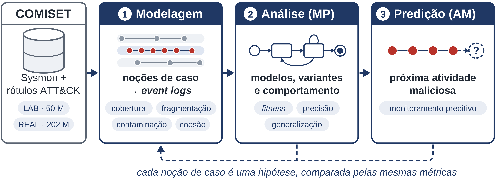
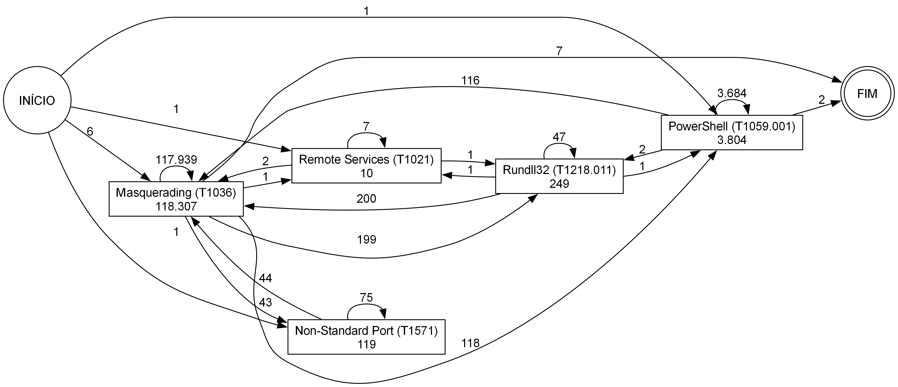

# Mestrado: Mineração de Processos na COMISET

**João Pedro Ramires Esteves**

> **Pergunta:** como agrupar eventos Windows em casos (a *noção de caso*) de forma que a Mineração de Processos revele a estrutura da atividade maliciosa?

Em logs de sistema, diferente de processos de negócio, não existe um identificador natural de caso. Aqui a noção de caso deixa de ser uma <ins>premissa</ins> e passa a ser o <ins>objeto de estudo</ins>.



**Base de Dados:** [COMISET](https://doi.org/10.5281/zenodo.15375145) (Pérez-Sánchez et al., 2025). Possui ~252 M eventos Windows ([Sysmon](https://learn.microsoft.com/pt-br/sysinternals/downloads/sysmon) e log nativo), rotulados com técnicas MITRE ATT&CK®, em dois cenários:

| Cenário | Eventos | Maliciosos | Período | Hosts |
|---|---:|---:|---|---:|
| **LAB** (ambiente controlado) | ~50 M  | 1,71 M (3,43%) | 16–25/nov/2022 | 3 |
| **REAL** (rede universitária) | ~202 M | 0,63 M (0,31%) | 27/jun–20/jul/2022 | 18 |

---

## 🚧 Agora: app Streamlit

O [Notebook 4](4_replicacao_sean.ipynb) virou um app Streamlit ([`app.py`](app.py)), que roda localmente e será deployado em breve. A ideia poder, **via web app**, trocar a modelagem e analisar os efeitos na hora, ao invés de se basear apenas em um notebook estático:

- **cenário:** LAB, REAL ou ambos (lado a lado)
- **noção de caso (agregação):** as 8 da §5 do notebook (IP de origem, o do Sean; IP de destino, par de IPs, host, usuário, programa, processo, processo-alvo) ou uma combinação de colunas à mão, com ou sem corte por dia
- **atividade:** técnica, técnica-pai, técnica + programa ou tipo de evento Sysmon
- **direção do tráfego:** só entrada (literal do Sean, apenas *inbound*), só saída, toda conexão ou todos os alertas
- **filtro extendido (além do Sean):** mínimo de atividades distintas por caso
- **dia analisado:** pelos critérios do Sean (mais alertas, mais casos, mais técnicas); o dia com mais eventos; escolhido à mão; ou todos juntos
- **saída:** o DFG (com zoom, os programas que disparam cada regra e exportação em SVG/PNG), a complexidade (pelo critério do Sean), o event log com os casos e suas sequências, as séries por dia e a comparação das 8 agregações

A URL guarda a modelagem inteira: é só copiar e mandar. O objetivo é usar o app para decidir qual modelagem seguir, ou mesmo quais insights podemos obter, antes de partir para descoberta de processos e predição.

---

## O que já foi feito

Os notebooks estão numerados em ordem cronológica.

### 1. Engenharia de dados: [`1.1`](1.1_compressao_lab.ipynb) e [`1.2`](1.2_compressao_real.ipynb)
NDJSON bruto convertido em Parquet-ZSTD com DuckDB, **sem descartar nenhum campo**.

LAB 160 GB → 2,6 GB / REAL 934 GB → 13,3 GB (~1,1 TB → 16 GB, ou seja, 98%+ de compressão).

### 2. Exploração: [`2.1`](2.1_exploracao_lab.ipynb) e [`2.2`](2.2_exploracao_real.ipynb)
- O schema é **muito heterogêneo**: 1.293 campos distintos no LAB e 897 no REAL, porque cada EventID tem seu conjunto específico de atributos.
- A maioria dos **atributos são extremamente esparsos**: só 32 (LAB) e 41 (REAL) aparecem em pelo menos 99% dos eventos.
- Rótulos ATT&CK, distribuição de EventID/EventType, e cardinalidades (hosts, usuários, processos, IPs) estão em [`saidas/lab/`](saidas/lab) e [`saidas/real/`](saidas/real).
- Os eventos provindos do Sysmon dominam: só o EventID 12 (`RegistryEvent`) responde por ~70% do LAB.
- Nome de usuário: o atributo `user_name` está em 79% dos eventos do LAB e em só 0,7% do REAL. Isso afetará qualquer noção de caso baseada em usuário.
- Foi feito um recorte das primeiras 24h de cada cenário (`d1`), para iterar rápido: LAB ficou com 3,5M eventos (3,7% maliciosos), REAL com 22M (0,28%).

### 3. Primeira noção de caso: `<host, process_guid>` (LAB, d1)
- **[`3.1`](3.1_eventlog_processo_lab.ipynb), construção do event log:** atividade = tipo de evento Sysmon (17 atividades).

  | Cobertura | Casos | Fragmentação (casos com 1 evento) | Coesão estrutural |
  |---:|---:|---:|---:|
  | 99,4% | 2.516 | 44% | **0** |

  Como o GUID é único por processo, ele **separa pai e filho em casos diferentes**. Isso nos apontaria para agregar pela **árvore de processos**. O log também foi exportado em XES (*just in case*).

- **[`3.2`](3.2_variantes_processo_lab.ipynb), variantes:** reduzindo a resolução temporal para 1 s e deduplicando, os 3,5M eventos viram 228 mil (-93,5%). Resultam 673 variantes; 25% delas cobrem 80% dos casos. Cruzando com os rótulos: 149 variantes benignas, 504 maliciosas e 20 mistas, que somam 55% dos casos. O sinal de ataque aparenta estar na cauda longa.

### 4. Replicação do Sean: [`4`](4_replicacao_sean.ipynb)
Transposição de Alvarenga et al. (2018) para a COMISET, nos dois cenários completos:

1. **Alertas** = eventos com rótulo ATT&CK (2,35M). Os IDs de técnica precisaram de higiene: havia IDs sujos (`"1210"`, `"T"`, `"Port Monitors"`) e versões diferentes do ATT&CK entre os cenários (por exemplo, T1130 foi deprecado e passou a ser T1553.004).
2. **Caso = `<IP de origem, dia>`**, com o filtro do Sean (descarta casos com uma técnica só) e DFG + critério de complexidade do artigo (eq. 2, 5 e 6).
3. **Achado principal:** no Sysmon quase não há tráfego de *entrada*. São só 587 alertas no LAB e 234 no REAL, então a replicação literal resulta em **3 casos no LAB e 1 no REAL**, e nenhum modelo é complexo. Um detalhe: no Sysmon, `src_ip` é a máquina monitorada, não o atacante, portanto é necessário verificar a direção por meio do campo `Initiated`.
4. **8 noções de caso alternativas** sobre todos os alertas ([`tabela_complexidade.csv`](saidas/sean/tabela_complexidade.csv)): as agregações por IP e por processo-alvo continuam gerando modelos simples ($\leq$ 7 vértices). Já **host, usuário, programa e processo geram modelos complexos** (29 a 45 vértices, até 580 arestas), que no Sean acionariam a etapa de clustering.

<p align="center"><br><sub>DFG à la Sean: LAB, caso = &lt;IP de origem, dia&gt;, todas as direções, 18/11/2022</sub></p>

---

## Estrutura do repositório

```
├── 1.1 .. 4_*.ipynb  notebooks, na ordem de execução
├── util.py           cron() (cronômetro de célula) e salvar() (parquet + csv)
├── app.py            o app Streamlit (uv run streamlit run app.py)
├── sean/             núcleo do webapp, sem Streamlit: modelagem, DFG, complexidade, desenho
│   └── dados/        alertas.parquet (~12 MiB), a única fonte que o app usa, versionada (está no git)
├── interface/        peças do app que dependem do Streamlit (tema, DFG interativo, gráficos)
├── .streamlit/       tema do app (claro e escuro)
├── saidas/           tudo que os notebooks geram
│   ├── lab/  real/   exploração (CSVs e figuras), recortes d1, event log
│   └── sean/         alertas, event logs, DFGs e tabelas do notebook 4
├── dados/            dataset completo em Parquet (fora do git)
├── docs/             material de referência (ver abaixo)
├── wtdcc/            resumo e pôster do WTDCC 2026
└── .githooks/        pre-commit que barra arquivos >50MiB
```

| `docs/` | |
|---|---|
| [`perez-sanchez_2025_comiset.pdf`](docs/perez-sanchez_2025_comiset.pdf) | artigo da COMISET (*Data in Brief*) |
| [`campos_lab.md`](docs/campos_lab.md) e [`presenca_campos.xlsx`](docs/presenca_campos.xlsx) | catálogo dos campos do `_source` e a presença de cada um |
| [`exemplo_evento_lab.json`](docs/exemplo_evento_lab.json) e [`exemplo_evento_real.json`](docs/exemplo_evento_real.json) | um exemplo de evento bruto de cada cenário |
| [`pesquisa_ocel.md`](docs/pesquisa_ocel.md) | levantamento sobre OCEL 2.0 e construção de event logs a partir de Sysmon |
| [`plano_app_streamlit.md`](docs/plano_app_streamlit.md) | o plano do app Streamlit e as decisões tomadas na implementação |

Arquivos grandes (como o dataset ou os recortes `d1`) **não estão no git**, porque são regerados pelos notebooks. As regras estão no [`.gitignore`](.gitignore).

---

## Como reproduzir

Pré-requisitos: [uv](https://docs.astral.sh/uv/), [Graphviz](https://graphviz.org/download/) (para os DFGs; no Windows, `winget install graphviz`, no Linux, o pacote também se chama `graphviz`) e bastante RAM e disco, já que o JSON bruto tem ~1,1 TB descompactado.

```bash
git clone git@github.com:jpramires/mestrado.git
```

```bash
uv sync
```

```bash
git config core.hooksPath .githooks
```

```bash
uv run jupyter lab
```

1. Baixe a COMISET do [Zenodo](https://doi.org/10.5281/zenodo.15375145) e aponte o caminho do JSON nos notebooks `1.x`, que geram `dados/`
2. Rode os notebooks na ordem em que estão numerados
    - O [notebook `4`](./4_replicacao_sean.ipynb) só depende de `dados/` (`lab_events.parquet` e `real_events.parquet`)

### O Webapp Streamlit

O app só precisa de [`sean/dados/alertas.parquet`](sean/dados), que já vem no repositório. Ele não usa `dados/` e não precisa do Graphviz instalado (o DFG é desenhado no navegador).

```bash
uv run streamlit run app.py
```

> Bônus: o código do app (`app.py`, `util.py`, `sean/` e `interface/`) passa no Pyright em modo strict:

```bash
uv run pyright
```

---

## Referências

- Alvarenga, S. C., Barbon Jr., S., Miani, R. S., Cukier, M., Zarpelão, B. B. *Process mining and hierarchical clustering to help intrusion alert visualization.* Computers & Security 73, 474–491, 2018. https://doi.org/10.1016/j.cose.2017.11.021
- Pérez-Sánchez, A., Palacios, R., López López, G. *COMISET: Dataset for the analysis of malicious events in Windows systems.* Data in Brief 61, 111723, 2025. [doi:10.1016/j.dib.2025.111723](https://doi.org/10.1016/j.dib.2025.111723)
